# Agently Front Desk

The AI front desk that turns a photo of a problem into an assessed job, a draft quote and a booked appointment. Six desks run on one spine: roofing, med spa, plumbing, AC and appliance repair, hair salon and barber. Built for the Meta Global AI Developer Hackathon (submission 4 November 2026).

**Live:** https://agently-frontdesk.vercel.app (product page at `/`, the demo business site at `/site`, the owner's desk at `/frontdesk`). It runs on Meta models: Muse Spark for chat, assessment and review, Muse Image for pictures, Muse Voice Transcribe for calls. Every screen says which provider answered. All businesses, customers, prices and photos are synthetic.

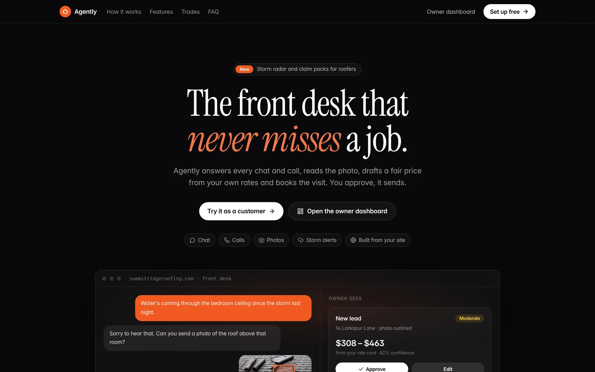

## Screenshots

Captured from a local build on the mock provider (no keys, deterministic answers), so the badge on screen reads "Mock provider". The live site runs the same screens on Meta models. All businesses, people, prices and photos are synthetic.

| | |
|---|---|
| 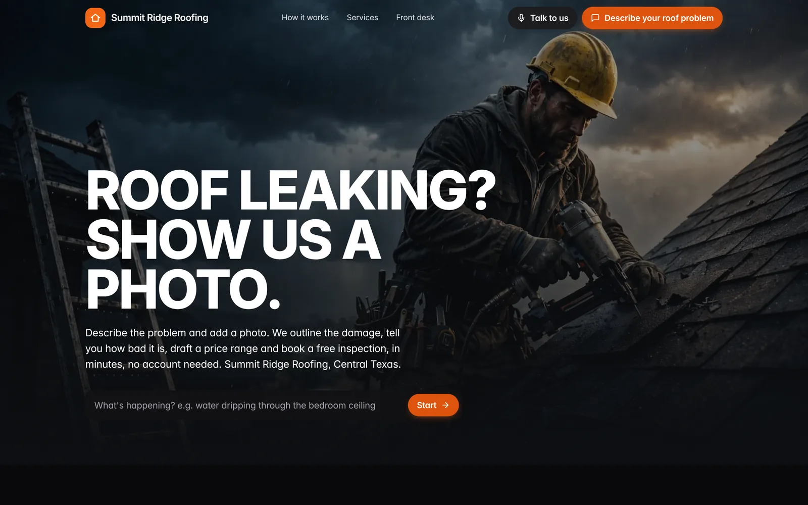 | 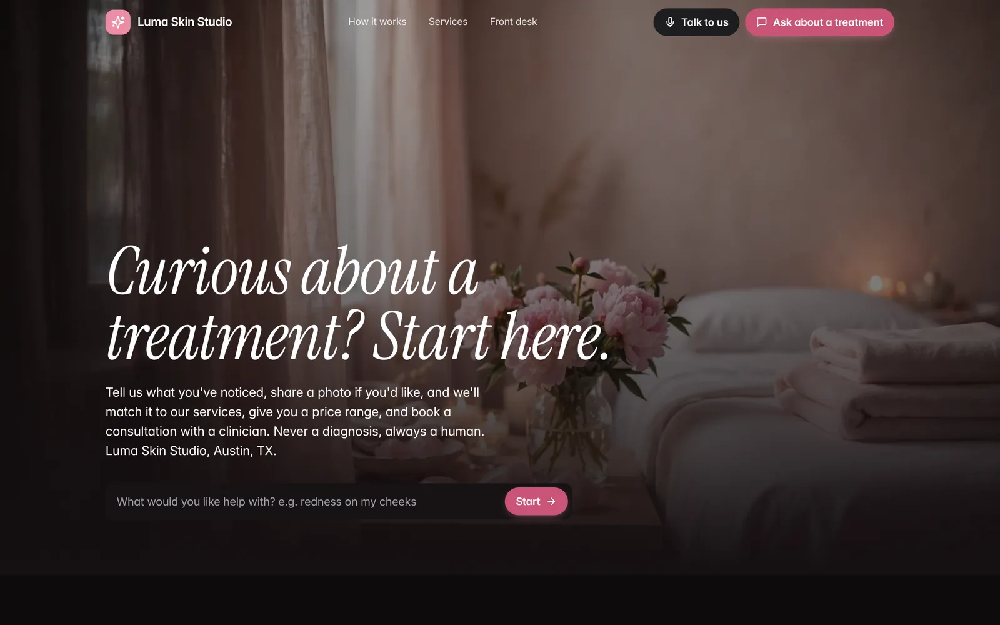 |
| **Each trade gets its own site** (`/site`). Roofing above, med spa beside it; plumbing, AC and appliance repair, salon and barber use the same spine. | The customer starts a chat from the hero, or talks to Aura by voice with "Talk to us". |
| 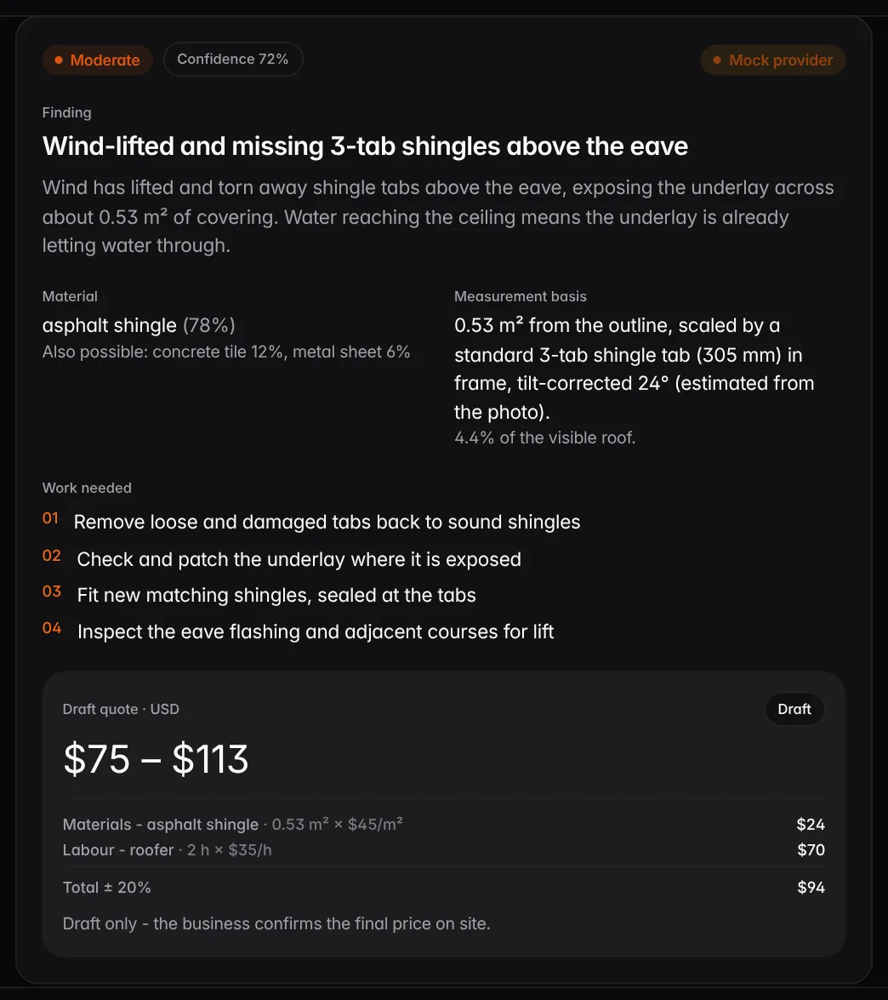 | 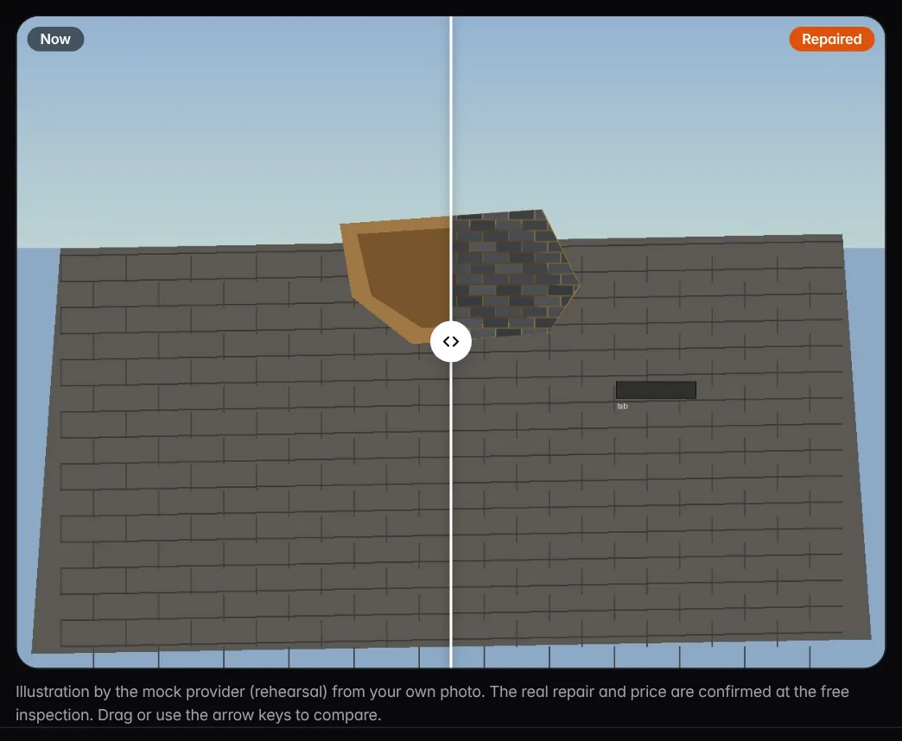 |
| **The assessment card.** Finding, material, measurement basis (scaled from a reference object) and a draft USD range priced line by line from the rate card. | **See it fixed.** A before and after slider of the customer's own photo, drawn with Muse Image on Meta. |
| 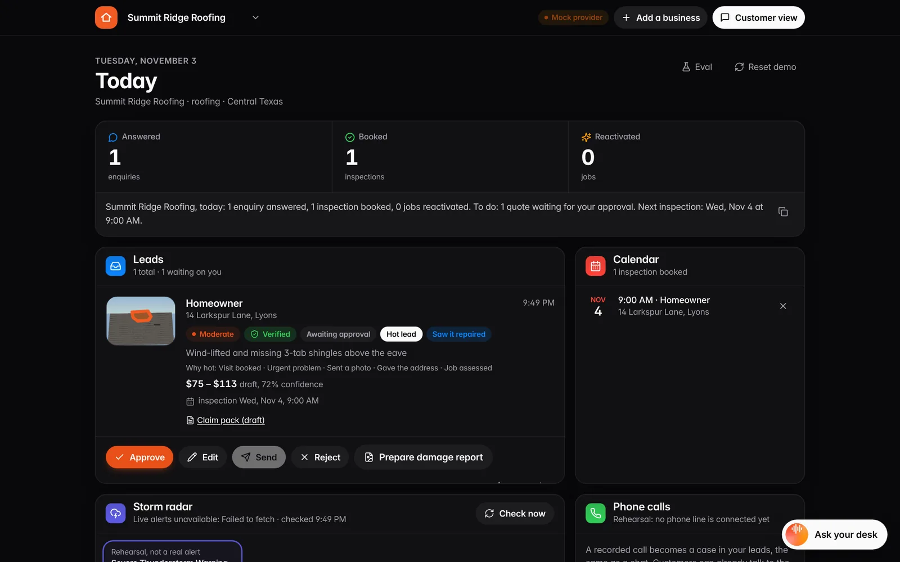 | 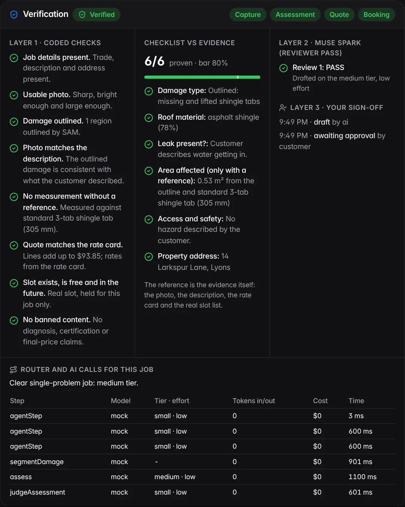 |
| **The owner's desk** (`/frontdesk`). Today in numbers, the daily summary, leads with their score and status, and the calendar. Approve, Edit, Send. | **Verification.** Coded checks, the checklist against the evidence, the reviewer pass and the owner's sign-off, plus every model call with its tier, tokens and time. |
| 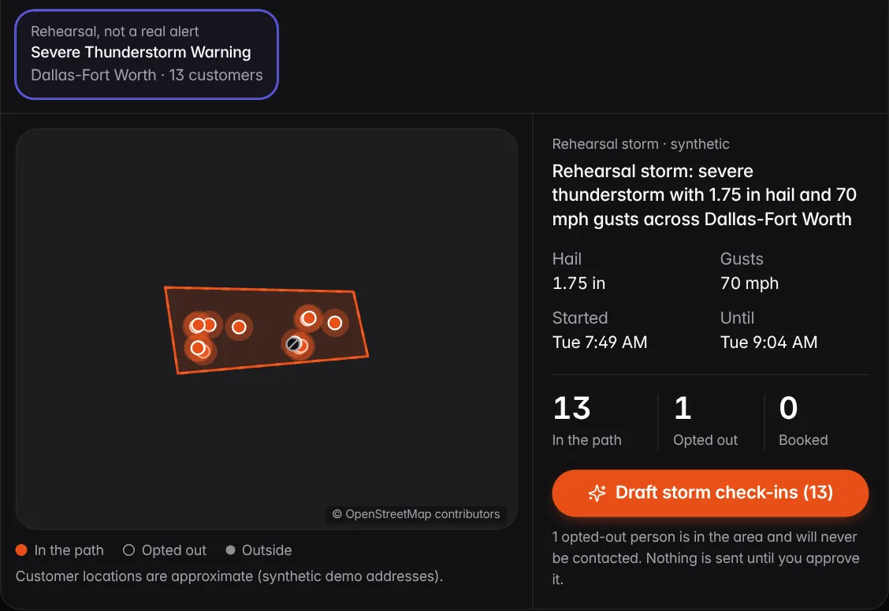 | 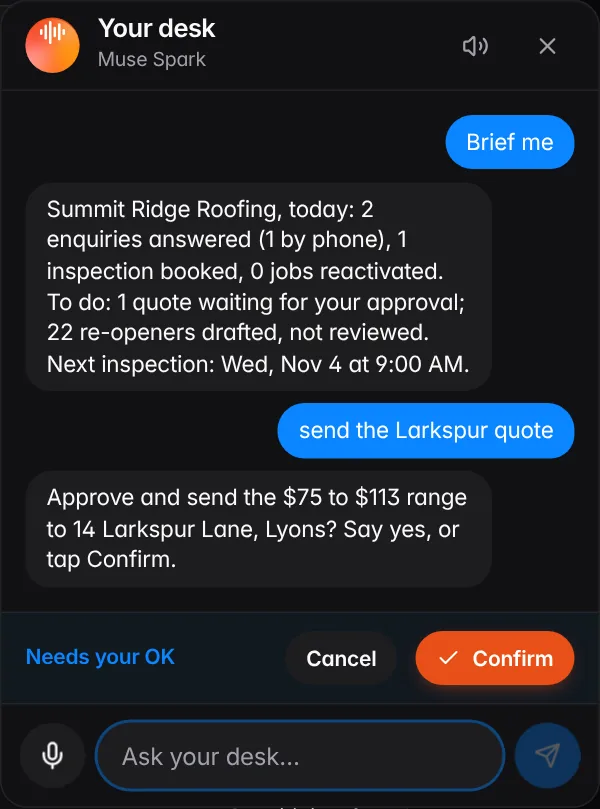 |
| **Storm Radar.** Customers in a storm's path, opted-out people excluded, check-ins drafted for approval. (The rehearsal storm is shown; the map tiles did not load in the capture environment.) | **Ask your desk.** The owner asks by text or voice ("brief me", "send the Larkspur quote") and confirms before anything is sent. |
| 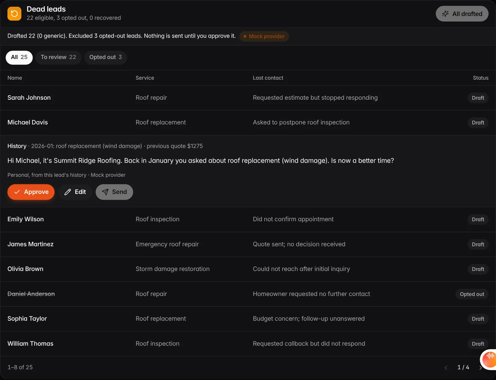 | 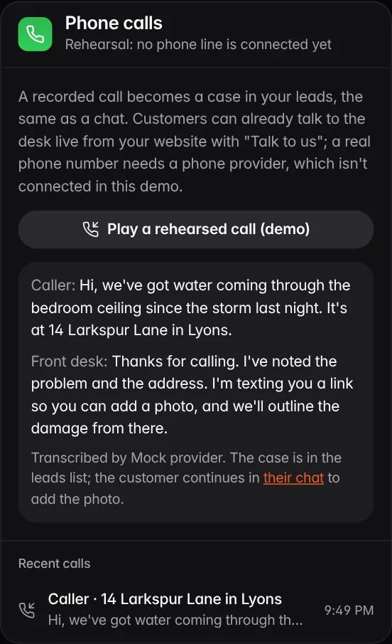 |
| **Dead leads.** Re-openers drafted from each lead's history; opted-out leads are excluded and counted. | **Phone calls.** A rehearsed call is transcribed and qualified into a lead, the same as a chat. |
| 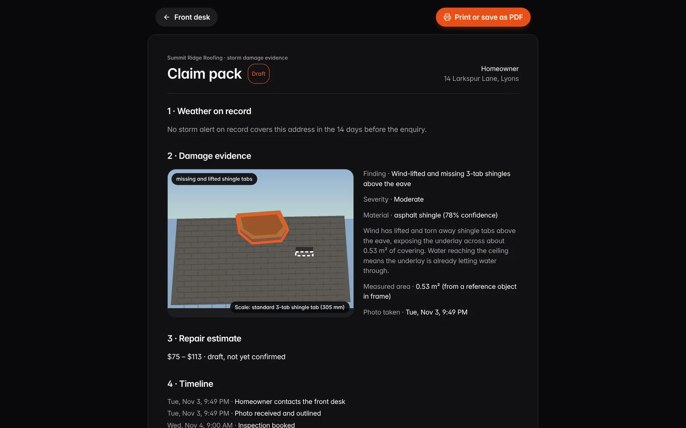 | 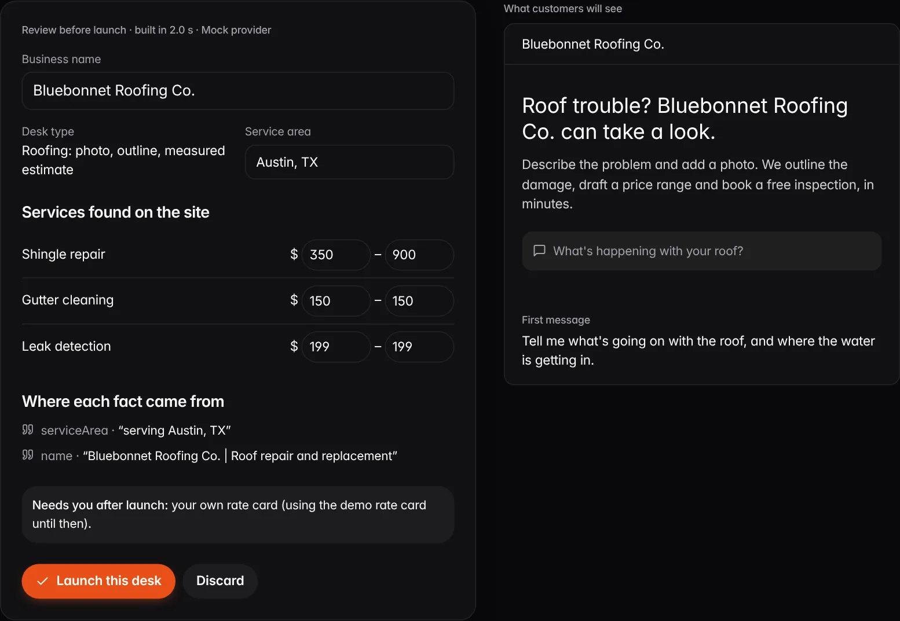 |
| **Claim pack (draft).** Weather on record, the photo evidence, the estimate and the timeline, ready to print for the insurer. | **Set up from your website** (`/setup`). The desk reads the business's site, shows where each fact came from, and launches after the owner reviews it. |

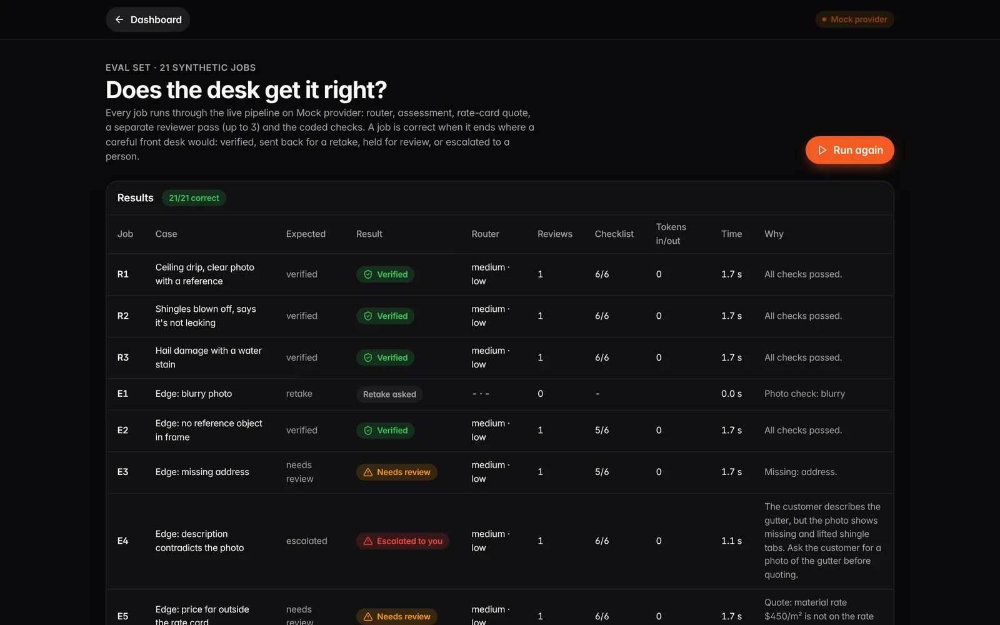

**The eval set** (`/eval`): 21 synthetic jobs run through the real pipeline, each with the expected outcome, the result, the router's choice, reviews, checklist coverage, tokens and time.

## Built during the hackathon (27 Oct to 4 Nov 2026)

Everything in this repository was built during the event, except the starting UI shell: a Base44 template export, committed first and marked "pre-hackathon, not event work" (`abe112b`), then removed piece by piece (see `docs/BASE44_INVENTORY.md`). Built at the event:

- The Eye: outline, measurement only with a reference object in frame, assessment and a rate-card draft quote (roofing).
- Menu engine for service trades: the concern is matched to the business's own published menu and priced from it, never by measurement (med spa, plumbing, AC, salon, barber).
- Verification: coded checks, a separate reviewer pass with up to 3 retries, a router that picks the model tier, and human sign-off with an audit trail. Eval set of 21 synthetic jobs.
- The desk agent: plan, look up (calendar, rates, business facts, history, storms), answer only from what it found.
- Owner desk: approve, edit and send quotes; dead-lead reactivation; Storm Radar and weather check-ins per trade (freeze for plumbing, heat for AC); phone-call transcription; daily summary; talk to your desk by voice.
- Customer extras: "See it fixed" (roofing) and "Preview the look" (salon, barber) with Muse Image; insurance claim pack draft (roofing); salon colour bookings held 48 hours after the patch test; med spa aftercare reminder drafts the clinician approves; live voice conversation with the desk ("Talk to us"), which introduces itself as Aura and names the business.
- Trust card: licence, insurance, warranty and reviews on the site and in the chat, answered by the desk. Demo businesses carry made-up credentials labelled as demo data; a business set up from its website shows only the site's own words.
- Insurance questions for storm damage (insurer, claim number, storm date), carried into the claim pack.
- Follow-ups on day 3, 7 and 14 after a sent quote, drafted ahead and sent only after the owner approves; they stop when the customer books.
- Lead score (hot, warm, cold) with its reasons, and "Take over the chat": the owner replies as a person and the AI pauses on that chat. Changes show live in another open tab.
- Set up a new business from its own website (`/setup`).

- Put the desk on any website: a no-code chat link and QR code per business (`/chat?site=<host>`), plus an optional one-line chat button (`widget.js`) that takes the business's own name, colour and icon.
- Owner alerts for new leads: push (also on iPhone from the Home Screen) and email.

### Fixed on 4 Nov 2026

- **Returning customers are remembered by address, on any device.** The address is read from what the customer types (`src/lib/address.js`), so "Do you remember me, 14 Larkspur Lane, Austin, TX?" looks up earlier enquiries at once. Each published desk keeps a small address book in the cloud (date, what was reported, where it got to; never a name, phone or email), so a customer on a new phone is still recognised.
- **Faster chat replies.** Customer chat and the voice desk run Muse Spark at minimal reasoning effort. Measured on the live site: median 4.3 s per reply (7 runs, 3.1 to 5.4 s), against 11.4 s at low effort. The grounding check still runs on every reply.
- **The website chat button is branded per business.** The line each business copies carries its own site (`widget.js?site=<host>`). The button reads the business's name, brand colour and icon, and greets in its trade. Each QR code opens that business's own chat.
- **Remove a business** from the desk (`/frontdesk`, two taps), with its published copy, so its website can be set up again from scratch. Only the browser that published it can remove the published copy.
- **Demo websites have an empty code box** (`demo-sites/embed/<site>.html`) for the business owner to paste the chat line into, instead of a pre-installed chat.

Nothing is sent, booked or priced without a person's approval. Draft quotes are USD ranges. The med spa desk never diagnoses or gives medical advice.

## The journey

1. Customer describes the problem in chat (`/chat`); the front desk asks for the address, then a photo.
2. The photo (or a frame picked from a short video) is checked for size, light and blur, shown back to the customer, then outlined (segmentation), measured (`src/lib/eye.js`: shoelace area, scale from a reference object, tilt correction; **no reference means no square-metre figure**), assessed, and priced from the rate card as a USD draft range with the maths and disclaimer shown.
3. The customer books a real inspection slot in three taps.
4. The owner sees the lead on the dashboard (`/frontdesk`), taps Approve, then Send. Status moves one way: draft → awaiting approval → approved → sent. The customer's chat shows the sent range.

## Run locally

```bash
npm install
npm run dev
```

Open http://localhost:5173. No keys are needed for the mock provider. To run on Meta, copy `.env.example` to `.env.local`, set `VITE_AI_PROVIDER=meta` and `META_API_KEY`.

On Windows PowerShell with script execution disabled, use `npm.cmd` instead of `npm`.

Rehearsal photos: `public/demo/roof-test.jpg` (reference object in frame) and `public/demo/roof-noref.jpg` (a file name containing `noref` makes the mock provider report no reference, so the no-reference rule can be rehearsed). Both are synthetic drawings.

## Walkthrough (10 minutes, no keys needed)

1. **Product page** (`/`) explains the product. Press "Try it as a customer" to open the demo business site (`/site`), type a problem in the field and press Start.
2. **Chat** (`/chat`): answer the address question, then add `public/demo/roof-test.jpg` (or any roof photo). Watch the outline, the assessment card, the measurement basis and the draft range with its maths. Pick a slot, confirm. Try "Talk instead" for the voice mode.
3. **Front desk** (`/frontdesk`): the lead is there with "Awaiting approval". Approve, then Send; the customer's chat now shows the confirmed range. "Show assessment" → "Correct the outline": drag a point and save; the range recomputes. "Prepare damage report" downloads the branded report.
4. **Dead leads** (right column): "Draft re-openers", open a lead, Approve, Send, then play the reply "Yes, book me in". The counter rises by one and the booking is on the calendar. Opted-out leads are excluded and counted.
5. **Phone calls**: "Play a rehearsed call"; the transcript is qualified into a new lead.
6. **Med spa**: switch the tenant in the header, then "Customer view": consent card, service match, clinician flags, consultation booking.
7. `public/demo/roof-noref.jpg` has no scale reference: the card shows percent only, no square metres and no dollar total.

"Reset demo data" on the Front desk clears everything.

## Verification, routing and the eval set (Meta workshop lessons)

Built on 2 Nov 2026 from the Agents 101, Agents 102 and Fireworks sessions. Everything below shows on the job's **Assessment** view on `/frontdesk`.

**Plan, act, verify** (`src/lib/pipeline.js`, shared by the chat and the eval):
1. The router picks a tier and effort, and Muse Spark drafts the assessment card. The price always comes from the rate card, never from the model.
2. A **separate reviewer pass** (`judgeAssessment`, Muse Spark) reads only the evidence and the card. It returns PASS, or FAIL with typed issues: contradiction, unsupported or missing.
3. On FAIL, the issues are fed back and the draft is retried one tier up. After 3 failed reviews the job is **escalated to a person** instead of looping.

**Three layers, visible on screen** (`src/lib/verify.js`):
- **Layer 1, coded checks.** Each one has its exact reason, and they run at four milestones: capture, assessment, quote and booking. The checks:
  - details present
  - usable photo
  - damage outlined, or "segmentation failed, escalate"
  - no area claimed without a reference object
  - quote lines add up and the rates are on the rate card
  - slot real, free and in the future
  - no banned content
- **Checklist vs evidence.** There is one checklist per trade in `src/config/policy.js`. Each item is PROVEN, NOT PROVEN (with the gap named) or ESCALATED, and items are compared with a tunable coverage bar (80% for roofing). Items the quote rests on (damage, material) or the consent rests on are required whatever the bar. The reference is the evidence itself: photo, description, rate card and slot list. There is no hidden answer key.
- **Layer 2:** the reviewer pass above.
- **Layer 3, human sign-off.**
  - Approve works directly only on a verified job. Any other job needs "Review & approve" with a written reason.
  - Reject also needs a reason.
  - Every step, edit and reason goes into the audit trail on the job.
  - The customer's range is held until the job verifies or a person signs it off.

**Router** (`src/lib/router.js`):

| Task | Tier | Effort | Human review |
|---|---|---|---|
| Customer chat turns and the voice desk | small | minimal (measured on the live site, 4 Nov: median 4.3 s per reply, against 11.4 s at low) | no |
| Re-openers and check-ins | small | low | no |
| Clear single-problem assessment | medium | low | no |
| Reviewer pass on a single-problem job | small | low (a medium-effort review took 34 s on Meta; the reviewer also gets a 512 px image) | no |
| Safety hazard, photo vs description conflict, several problems | large | high | forced |
| Retry after a failed review | next tier up | higher | after 3 failures |

Model ids come from env (`VITE_META_TIER_SMALL_MODEL`, `_MEDIUM_`, `_LARGE_`). Without them, every tier uses the configured Muse Spark model and only the reasoning effort changes; nothing invents a model name. Every call is logged per job with model, tier, effort, tokens, latency and router reason. Cost appears only when `VITE_META_PRICE_IN_PER_M` and `VITE_META_PRICE_OUT_PER_M` are set. It is never estimated.

**Eval set** (`src/eval/jobs.js`) has 21 synthetic jobs:
- 3 clear roofing jobs.
- 8 edge cases: blurry photo, no reference, missing address, description contradicts photo, price off the rate card, sparks near water, unsure material, two problems in one photo.
- 3 med spa jobs, one with no consent recorded.
- 7 jobs across plumbing, AC and appliance repair, salon and barber.

To run it:
- `npm run eval` runs the mock and writes [docs/EVAL.md](docs/EVAL.md), currently 21/21 on the mock.
- `/eval` runs the same jobs live through the gateway, so on Meta it records real tokens and time.

Carpentry and bricklaying are not built in this submission.

**Rehearse the failure on purpose:** start a chat with "The gutter is hanging off the front of the house and water pours down the wall", then add `public/demo/roof-test.jpg`. Here is what happens:
1. The reviewer flags the contradiction 3 times.
2. The customer is told a person is checking it.
3. The job shows "Escalated to you" on the dashboard and needs a reason to approve.

## The desk agent: plan, look up, answer

Each customer message runs a short plan-act-observe loop (`src/lib/agent.js`, at most 3 lookups). Muse Spark either calls one tool or answers:

| Tool | Reads |
|---|---|
| `check_calendar` | Real open slots for the next 7 days, optionally on a named day |
| `rate_card` | Published roofing rates per m², labour per hour and service prices printed on the business's website (never a job total), or the med spa menu |
| `business_facts` | Name, service area, first visit, the setup summary and the quotes read from the business's own website at setup. Anything else is "not on my record" |
| `customer_history` | Earlier enquiries from the same address, in this browser and in the desk's cloud address book. It runs as soon as the customer gives an address |
| `storm_reports` | Weather-service storm reports on record |

Fast path: the lookups a question plainly needs (picked from its wording by `planLookups`) run in code before the model is called, so a question like "how much, and can you come tomorrow?" takes one Muse Spark call instead of two or three. The model can still ask for a lookup the planner missed. The answer may state only facts a tool returned. A coded grounding check holds back any clock time or dollar figure that no lookup, no earlier message and no approved quote contains. The customer sees small "Checked the calendar" chips under a reply. The owner sees "How the desk answered" on the lead: each plan, each lookup and what it found, and whether the reply passed grounding. A question is never taken as the job description or the address, and the desk carries on qualifying the job after answering. Tests: `tests/agent.test.js` (10) and the "smart desk" e2e journey.

## Layout

- `src/gateway/` — the AI Gateway: `segmentDamage`, `assess`, `converse`, `reactivateMessage`, `renderReportVisual`, `transcribeCall`. Providers: `mock` (deterministic rehearsal) and `meta` (Meta models). Every call is logged with capability, latency and provider.
- `prompts/prompts.md` — every prompt, versioned.
- `src/lib/store.js` — the case record, calendar slots and gateway log (localStorage, synthetic data only).
- `src/lib/seed.js` — demo tenants (fictional, names locked), placeholder rate card, inspection slots.
- `src/lib/eye.js`, `src/lib/quote.js` — measurement and quote maths, pure functions.
- `src/pages/` — the screens: `Product.jsx` (`/`), `Home.jsx` (the business site, `/site`), `Chat.jsx` (`/chat`), `Frontdesk.jsx` (`/frontdesk`), `ClaimPack.jsx` (`/claim/:id`), `Setup.jsx` (`/setup`) and `Eval.jsx` (`/eval`).
- `src/config/` — per-trade settings (`trades.js`), site copy (`siteCopy.js`), photos (`media.js`) and verification checklists (`policy.js`).
- `docs/screenshots/` — the images in this README. `scripts/guide-shots.mjs` retakes the full set of screens with Playwright.
- `docs/BASE44_INVENTORY.md` — what the starting build contained and what was replaced.

## Checks

```bash
npm test        # Eye maths, quote rules, verification, router, gateway contract against the mock provider
npm run eval    # the 21-job eval set on the mock; writes docs/EVAL.md
npm run lint
npm run build
```

`tests/golden.test.js` scores the Eye against `tests/golden/manifest.json` (hand-checked outlines, reference objects, materials): outline IoU, area within 20% when a reference is present, material right on most. Two synthetic photos are in it today; the brief's 12 real photos (3 materials × 2 damage types × 2 angles) go in the same manifest. `GOLDEN_PROVIDER=mock` is the default.

`tests/contract.js` is the gateway contract. The same contract runs against the Meta provider when it is configured, so both providers are proven by the same tests.
